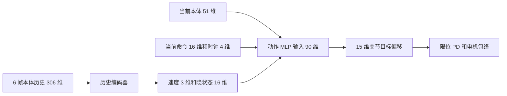

# Sable 16 维命令与 6 帧历史策略实现方案

版本：`sable_cmd16_hist6_v1`。日期：2026 年 10 月 27 日。用途：供后续实现 agent 建立新运动策略接口、迁移现有能力、执行分阶段训练与验收。

远程主文件：`/root/gpufree-data/projects/sable-isaacgym/planning/sable_cmd16_history6_migration.md`。

本地备份：`E:/1_project_E/code/remote_sable_robot/planning/sable_cmd16_history6_migration.md`。

本版目标是保留当前构型已经学到的基础运动，逐步获得可调速度、身体姿态、步频与接触时序的统一底层策略。接口固定为 **16 维命令、每帧 51 维本体观测、6 帧本体历史、4 维当前时钟、15 维动作**。部署原始输入共 **326 维**；历史编码后，动作 MLP 接收 **90 维**。

用户已确定胸部 roll 的含义是前躯干相对地面的左右侧倾，不是胸部 pitch，也不是肩部电机角度。保留腰部 pitch、腰部 roll、肩高与髋高。后续跑跳、蓄力跳、攀爬、情绪表达可以扩展这套底座，但这些能力不属于本次基础迁移的完成标准。

接口维数与命令语义是本版约定。网络隐藏层、critic 默认布局、训练阈值及课程起始范围是供实现采用的工程默认值；硬件限值、姿态可达范围和性能结论必须由模型与实验确定。下面的设计综合了 WTW、HIMLoco、DAgger 和 APEX 的思路，不是其中某个开源项目的原样复现。

## 1 当前基线与实现边界

远程主线在本次文档核验时已推进到 `stand5_20261027_v43_event_angles`。前一次讨论使用 v42 快照；v43 保留其观测、动作和物理接口，调整了部分奖励。实现前重新检查最新运行和开发源，教师选择依据独立评估，不自动把最新 checkpoint 当作最佳教师。

| 项目 | 本次核验结果 | 迁移含义 |
| --- | --- | --- |
| 策略观测 | 58 维，无历史堆叠 | 旧 checkpoint 不能直接按 326 维载入 |
| 策略动作 | 14 维 | 新策略追加腰部 pitch，形成 15 维 |
| 物理执行器 | 15 个独立执行器，另有一个被动后髋 roll 坐标 | 不增加被动关节的动作维数 |
| 腰部 pitch | `spine_pitch` 由 PD 保持约 −40° | 先保持原姿态，参考退出后再开放探索 |
| 控制频率 | 物理步长 0.0005 s，decimation 40，即 50 Hz | 6 帧包含当前帧和过去 5 帧，首尾相隔 100 ms |
| 步态 | 每腿 1 Hz，支撑比例 0.5，保留原四足相位次序 | 不按早期 0.8 s 周期或 0.75 支撑比例初始化 |
| 控制方式 | 默认姿态＋运动参考＋网络残差，经限幅和 PD | 蒸馏完整控制目标 |
| 参考幅度 | strength 0.75，腿部幅度乘数 4/3，另有启动 ramp | 不能把 0.75 解释成只有 75% 的最终参考贡献 |
| 速度命令 | 配置 4 个内部字段，actor 读取前 3 个；采样主要为前向 0.09–0.12 m/s 和部分零速 | 还不是完整的全向速度课程，heading 反馈与直接 yaw 命令要分清 |
| 观测噪声 | `add_noise=true`，但 `noise_level=0` | 当前没有有效观测噪声；动作探索标准差是另一回事 |
| 随机化 | 摩擦随机化开启，推扰与基座增重随机化关闭 | 保留已存在的随机化，再逐级扩展 |
| v43 奖励变化 | 删除膝部偏好区间成本；踝部改为真实着地／离地事件角度成本；加入腰部竖直加速度成本 | 不恢复旧的膝部偏好或踝部连续相位成本 |

基线代码与配置：

- [v43 配置](/root/gpufree-data/projects/sable-isaacgym/runs/stand5_20261027_v43_event_angles/config.json)
- [v43 环境实现](/root/gpufree-data/projects/sable-isaacgym/runs/stand5_20261027_v43_event_angles/runtime/sable_env.py)
- [v43 步态与足端计算](/root/gpufree-data/projects/sable-isaacgym/runs/stand5_20261027_v43_event_angles/runtime/gait_support.py)
- [v43 镜像映射](/root/gpufree-data/projects/sable-isaacgym/runs/stand5_20261027_v43_event_angles/runtime/policy_symmetry.py)
- [v43 策略包装](/root/gpufree-data/projects/sable-isaacgym/runs/stand5_20261027_v43_event_angles/runtime/equivariant_policy.py)
- [v43 物理清单](/root/gpufree-data/projects/sable-isaacgym/runs/stand5_20261027_v43_event_angles/runtime/assets/physical_manifest.json)

本次核验对应的开发源是 `/root/gpufree-data/projects/sable-isaacgym/deployment/legged_gym_event_angles_20261027`。`runs/.../runtime` 是冻结证据，不是直接修改的开发目录。新实现使用新的开发目录与运行目录，例如 `/root/gpufree-data/projects/sable-isaacgym/deployment/legged_gym_cmd16_hist6_20261027`，保留原教师、资产与运行记录。

执行时遵循远程 [AGENTS.md](/root/gpufree-data/projects/sable-isaacgym/AGENTS.md) 的最新约定。本文交付本身只新增文档，不启动、停止或接管现有训练。后续训练按实际任务授权执行；已有授权不重复申请。Windows 本机不运行 RL 训练或参数搜索。模型迁移不同时重建机械几何、改质量分布或更换电机模型。

## 2 命令契约

命令向量记为 `c_t`，形状 `[N, 16]`。内部使用 SI 单位，角度为弧度。归一化放在统一适配层完成；记录和 UI 同时保留物理单位值。

| 索引 | 字段 | 单位 | 含义与初始化 |
| --- | --- | --- | --- |
| 0 | `vx` | m/s | 前后速度，初始覆盖教师原范围 |
| 1 | `vy` | m/s | 左右速度，初始 0 |
| 2 | `yaw_rate` | rad/s | 偏航角速度，初期通过适配器复现教师 heading 行为 |
| 3 | `shoulder_height` | m | 前躯干左右肩部基准点的平均离地高度 |
| 4 | `hip_height` | m | 后躯干左右髋部基准点的平均离地高度 |
| 5 | `gait_frequency` | Hz | 同一条腿完成一个完整周期的频率，初始 1.0 |
| 6 | `phase_fr` | cycle | 右前腿相对左前腿的相位，初始 0.5 |
| 7 | `phase_hl` | cycle | 左后腿相对左前腿的相位，初始 0.25 |
| 8 | `phase_hr` | cycle | 右后腿相对左前腿的相位，初始 0.75 |
| 9 | `stance_fraction` | 无量纲 | 每腿周期中期望支撑比例，初始 0.5 |
| 10 | `swing_height` | m | 足部碰撞几何最低点的目标抬升高度，初始沿用当前每足 0.023 m 的目标 |
| 11 | `chest_roll` | rad | 前躯干相对地面水平面的侧倾角 |
| 12 | `waist_roll` | rad | 腰部相对 roll 角，对应 `spine_roll` 的已标定语义 |
| 13 | `stance_width` | m | 站姿宽度控制量；前后足可有不同基准宽度 |
| 14 | `waist_pitch` | rad | 腰部相对 pitch，默认约 −0.6981317，即 −40° |
| 15 | `aux_reward_coeff` | 无量纲 | 预留调节系数，v1 固定 1.0，不随机化、不缩放整个总奖励 |

第 15 项需要先明确它调节的具体目标才有行为含义；当前是预留通道，因此“16 维接口”不代表已经学会 16 个独立可调目标。不要把它自动当作情绪、活力或温控参数。

身体坐标沿用模型约定：X 向前、Y 向左、Z 向上。最终平面速度命令以机体航向对齐的水平坐标系表达，yaw 表示绕地面竖直方向的航向变化；本体观测和速度估计使用与 IMU 对齐的 ROOT 坐标系。两者通过姿态变换连接。迁移早期保留旧教师的速度／yaw 计算，进入全向与姿态课程时统一命令适配与奖励定义；身体有 roll／pitch 时，不能直接把机体系角速度 Z 无条件等同于航向角变化率。

肩高、髋高的两个基准点必须在物理清单中登记名称和局部坐标，避免误用网格原点或足端位置。高度按左右点的平均值定义，不要求侧倾时左右点等高。v1 使用平地高度；引入地形后要明确局部地面估计。初始高度、胸部 roll 和宽度由基线姿态与稳定运动统计确定，不猜一个米数。

胸部 roll 是任务空间目标，不增加胸部执行器。腰部 roll／pitch 是相对关节目标。用完整正向运动学计算它们之间的关系，不用欧拉角简单相加代替。姿态命令要通过可达范围检查，不能把肩高、髋高、腰部 pitch／roll 和胸部 roll 的独立均匀随机组合全部送入训练。

宽度建议采用一个公共增量：`w_front = w_front0 + delta_w`，`w_hind = w_hind0 + delta_w`，其中 `delta_w = stance_width - width0`；三个基准量写进配置。保留左右符号，避免交叉站姿被绝对距离误判为满足宽度。取消原站姿长度命令后，足端前后落点由策略优化；腰部 pitch 不等价于站姿长度。

## 3 步态时钟与停止逻辑

统一足序为 `[FL, FR, HL, HR]`，对应左前、右前、左后、右后。所有时钟、接触、足端数据按名字映射到该顺序，不能假设仿真 body index 正好一致。

用左前腿的全局相位 `phi` 和三个相对相位构造局部相位：

```text
delta = [0, phase_fr, phase_hl, phase_hr]
phi_next = (phi + gait_frequency * control_dt) mod 1
phase_i = (phi + delta_i) mod 1
```

当前旧代码的绝对偏移为 `[0.75, 0.25, 0.0, 0.5]`。等价迁移为 `phi_new = (phi_old + 0.75) mod 1`，相对偏移 `[0, 0.5, 0.25, 0.75]`。初始相位还要包含旧环境自己的 reset offset；只复制三个数而忽略全局相位会改变起步。

采用 WTW 风格的四足时钟，每足一个标量。用支撑比例 `beta` 把支撑、摆动分别映射到半周期：

```text
u_i = phase_i / (2 * beta)                              if phase_i < beta
u_i = 0.5 + (phase_i - beta) / (2 * (1 - beta))          otherwise
clock_i = sin(2 * pi * u_i)
```

`beta` 必须严格处于 `(0, 1)`，课程范围另行限制；停止不通过令 `beta=1` 实现。频率变化通过相位积分连续推进，禁止每帧用 `episode_time / newly_changed_period` 重算相位。相位命令按圆周最短距离平滑过渡，训练与评估覆盖 0／1 边界。四个正弦值不是四个完整相位的可逆编码；本版沿用 WTW 的紧凑输入，若后续遇到相位辨识问题，再做显式 sin/cos 编码对照并升级接口版本。[WTW 时钟实现](https://github.com/Improbable-AI/walk-these-ways/blob/0e7236bdc81ce855cbe3d70345a7899452bdeb1c/go1_gym/envs/base/legged_robot.py#L753)

本版三个相位命令保持标量编码，因此命令仍为 16 维。将这三个命令另行改为各自 sin/cos 会增加输入维数，不能在不更新 schema 的情况下实施。

S0–S2 保持教师原有起停行为。S3 加入明确的停止课程：使用平面速度与 yaw 命令共同判定运动意图，并加入滞回；纯转向也属于运动。停止时撤去周期接触约束、目标转为稳定支撑，时钟采用约定的静止值并训练相同切换过程。阈值依据这台低速机器人标定，不照搬 WTW 的速度死区。静止、起步、制动和恢复行走都进入回归集。

## 4 动作契约

动作 `a_t` 形状为 `[N, 15]`。保留旧 14 维顺序并在末尾追加 `spine_pitch`：

```text
 0 spine_roll
 1 hip_roll
 2 L_shoulder_roll
 3 L_shoulder_pitch
 4 L_elbow_pitch
 5 L_hip_pitch
 6 L_knee_pitch
 7 R_shoulder_roll
 8 R_shoulder_pitch
 9 R_elbow_pitch
10 R_hip_pitch
11 R_knee_pitch
12 L_ankle_pitch
13 R_ankle_pitch
14 spine_pitch
```

最终控制定义为 `q_target = clip_joint_limits(q_default + action_scale * a_t)`。`q_default` 在一个模型版本内固定，不随姿态命令更新；姿态命令进入策略与奖励。`R_hip_roll_mimic` 保留单电机反向联动，不作为第 16 个动作，不对它施加独立电机力矩。

初期前 14 维保留原缩放 0.35；新增腰部 pitch 的缩放在配置中显式给出，可从 0.35 rad／单位动作开始。输出可表示范围必须覆盖教师的完整目标，不可在蒸馏时擅自加 `tanh` 和过小的动作裁剪，把原先由参考提供的运动幅度截掉。最终仍通过关节限位、PD 和原有力矩—转速包络执行。

新腰部 pitch 的均值输出先固定 0，即目标保持默认 −40°；早期同时屏蔽该维执行与探索。不要创建标准差为 0 的无效高斯分布：可以保留正数标准差并从早期优化目标中屏蔽该维，或使用明确支持冻结维度的分布。解除冻结后再逐渐增加探索幅度。

## 5 观测与网络契约

### 5.1 本体观测与历史

每帧 `p_t` 为 51 维，以下切片均为 Python 左闭右开区间：

| 切片 | 字段 | 维数 |
| --- | --- | --- |
| `[0:3]` | ROOT／IMU 坐标系角速度 | 3 |
| `[3:6]` | ROOT／IMU 坐标系单位重力投影 | 3 |
| `[6:21]` | 15 个独立关节相对固定默认姿态的位置 | 15 |
| `[21:36]` | 15 个独立关节速度 | 15 |
| `[36:51]` | 上一控制区间末实际执行的完整关节目标偏移 | 15 |

最后一项定义为 `u_exec_prev = (q_exec_prev - q_default) / action_scale`，使用限幅后的目标，包含迁移期教师与参考的贡献。它不同于旧模型的“上一拍残差网络动作”。若有目标插值，记录上一控制区间末的执行目标，并另外在诊断数据中保存子步轨迹。

历史张量形状为 `[N, 6, 51]`，按当前到过去排列：`[p_t, p_(t-1), ..., p_(t-5)]`。展平得到 `[N, 306]`。每次观测采样只入队一次；不跨并行环境或 episode 混合。reset 时用新的初始观测重复填满六帧，清除旧 episode 的动作与估计状态；实机启动也使用相同逻辑。

当前命令和当前时钟不进入历史缓存。部署接口可采用三个命名张量：

```text
history:  [N, 6, 51]
commands: [N, 16]
clocks:   [N, 4]
```

单张量导出时统一布局为 `concat(history.flatten, commands, clocks)`：`[0:306]` 历史、`[306:322]` 命令、`[322:326]` 时钟。

### 5.2 历史编码器与动作网络

历史编码器：`E(H_t) -> (v_hat_t[3], z_t[16])`。`v_hat_t` 表示当前 ROOT 坐标系机体线速度，`z_t` 是无人工物理标签的隐状态。建议初始 MLP 为 `306 -> 128 -> 64 -> 19`；隐状态可做 L2 归一化。

动作网络输入固定为：

```text
actor_input = concat(p_t, commands_t, clocks_t, scaled_v_hat_t, z_t)
             51    + 16         + 4       + 3             + 16 = 90
action_mean = Actor(actor_input)                                = 15
```

对应切片：本体 `[0:51]`，命令 `[51:67]`，时钟 `[67:71]`，估计速度 `[71:74]`，隐状态 `[74:90]`。动作 MLP 隐藏层可先采用 `[512, 256, 128]`，后续按实际部署耗时优化。推理测速要包含历史编码器、任何镜像双分支计算、动作网络和数据搬运，不能只测 90 维输入这一层。



HIMLoco 官方配置采用 6 帧历史，动作网络拼接当前观测、3 维估计速度和 16 维隐状态。本版仅借鉴该结构，把命令与时钟放在独立当前输入分支。它与 HIM 原始的完整单帧历史布局不同。[HIM 配置](https://github.com/InternRobotics/HIMLoco/blob/ef289acaa62795009363b7b819c9186690630441/legged_gym/legged_gym/envs/base/legged_robot_config.py#L30)、[HIM 网络](https://github.com/InternRobotics/HIMLoco/blob/ef289acaa62795009363b7b819c9186690630441/rsl_rl/rsl_rl/modules/him_actor_critic.py#L69)

| 常见维数 | 正确含义 |
| --- | --- |
| 51 | 单帧本体 |
| 71 | 当前本体＋当前命令＋当前时钟 |
| 306 | 6 帧本体历史 |
| 326 | 本版部署原始输入 |
| 90 | 本版历史编码后的动作 MLP 输入 |
| 426 | 将完整 71 维单帧全部堆叠 6 次的另一种结构，本版不采用 |
| 15 | 独立关节动作输出 |

### 5.3 训练专用信息与估计器目标

部署 actor 不读取仿真真实线速度、真实接触力、真实离地高度或未来状态。仿真真实线速度可用于教师、critic 与估计器监督。

为了让实现 agent 有明确起点，新增一个可独立版本化的 critic 默认布局 `critic_v1_92`。这是本方案的实现默认值，不是 WTW 或 HIM 的原始 critic 维数：

| 切片 | 内容 | 维数 |
| --- | --- | --- |
| `[0:51]` | 当前无观测噪声的本体字段，保留实际执行目标语义 | 51 |
| `[51:67]` | 当前命令 | 16 |
| `[67:71]` | 当前时钟 | 4 |
| `[71:74]` | 当前真实 ROOT 线速度 | 3 |
| `[74:76]` | 实际肩高、髋高 | 2 |
| `[76:80]` | 四足实际最低点离地高度 | 4 |
| `[80:92]` | 四足接触合力，每足 ROOT 坐标系 XYZ | 12 |

critic 不部署。以后添加地形、摩擦或执行器参数时更新其专用 schema，不能把部署 actor 的 326 维跟着静默改变。接触合力来源和单位要明确；它不能直接被称为某个精确接触点的力。

估计器使用同一时刻标签 `H_t -> v_t` 做速度监督，标签以命名字段读取，物理单位与预测保持一致。actor 侧再按固定速度尺度归一化一次。隐状态分支可采用 HIM 风格的相邻状态对比／原型学习，目标为干净的下一帧本体表征；下一帧只出现在辅助损失目标，不进入当前 actor。默认由估计器自己的辅助损失更新，actor 使用其输出的 detach 版本，避免只有速度损失却让 16 维隐状态长期不受训练。[HIM 估计器](https://github.com/InternRobotics/HIMLoco/blob/ef289acaa62795009363b7b819c9186690630441/rsl_rl/rsl_rl/modules/him_estimator.py)

HIM 原代码通过特定 critic 切片组织标签，不能复制那些数字来解释本版 92 维 critic。存储显式的 `v_t`、`p_t`、`p_next`、`done`，并屏蔽跨 reset 的相邻状态对。PPO 的 time-limit bootstrap 与真正终止分开处理；自动 reset 后的新初态不能冒充旧 episode 的终态监督标签。

### 5.4 归一化和噪声

固定字段顺序、坐标系、缩放、裁剪及历史顺序，随 checkpoint 一起导出。先沿用当前已验证的本体尺度并增加新关节映射，命令采用各字段物理范围归一化。角速度、关节速度、重力等噪声按命名切片施加；命令、时钟、执行器已知目标不加传感器噪声。

6 帧是短时运动信息，不覆盖当前 1 s 的完整步态周期；周期位置由时钟补充。延迟若超过可用历史时间、温度若需要长期状态，分别增加执行缓存或能力管理，不能声称六帧已经记住所有慢变量。

## 6 完整控制器蒸馏

教师的完整目标含人工参考与策略残差：

```text
q_T = clip_joint_limits(q_default + q_reference + scale * a_T)
q_S = clip_joint_limits(q_default + scale * a_S)
```

数据标签是 `q_T` 或等价归一化的 `(q_T - q_default) / scale`。原教师只有 14 维输出，第 15 维标签取教师保持的腰部 pitch。不要直接将旧 14 维 `a_T` 当成新学生完整动作的标签。

推荐步骤：

1. 冻结教师及其环境、参考表、normalizer、默认姿态和物理清单；采集原能力域的轨迹、完整目标与本体历史。
2. 行为克隆预训练新学生，同时训练速度／隐状态估计器。输入输出层变更采用显式参数映射；报告复用、跳过和新初始化的权重，不用无说明的 `strict=False` 宣称旧能力已保留。
3. 学生开始闭环采样，在学生访问的状态上查询冻结教师并聚合数据，修正分布偏移。教师仅在其原能力域提供模仿约束，不让前向教师强行指导尚未学过的横移或大幅腰部姿态。[DAgger 原论文](https://proceedings.mlr.press/v15/ross11a.html)
4. 需要过渡时混合完整目标：`q_exec = (1 - eta) * q_T + eta * q_S`，逐渐从教师转向学生。保留原控制插值、限幅与 PD 语义，比较实际子步目标；教师参考在物理子步内变化时，不能只对齐一个 50 Hz 样本就认为两种控制完全相同。
5. `eta=1` 后独立运行，确认执行链和 actor 都不再调用参考表。随后才进入新的速度、姿态、步频课程。教师数据仍可作为辅助回归，但执行器端没有教师贡献。

过渡混合轨迹用于模仿数据采集。第一版 PPO 从学生完全执行的轨迹开始；不要把混合教师执行的轨迹直接当作普通学生 on-policy PPO 数据。旧轨迹可用于 BC／辅助学习，不用于伪装成最新 PPO rollout。

教师查询时保留原 58 维观测语义：参考的滤波速度、ramp、相位都按真实仿真时间推进。旧教师的 previous-action 字段是残差；学生执行期间需要从实际目标与同一时刻参考重建等效残差，或采用经过验证的教师适配状态，不能把新的完整目标偏移直接塞入旧字段。

本版通过退出完整教师控制来消除直接参考依赖。不要在已经输出完整目标的学生后面再次叠加原参考。APEX 的衰减动作先验支持“先引导探索、再退出”的方向，但完整目标混合、DAgger 与本项目课程是本方案的组合设计。[APEX 论文](https://arxiv.org/abs/2505.10022)

## 7 分阶段训练课程

每阶段独立保存配置、模型、父 checkpoint、物理资产哈希和评估结果。阶段切换由指标决定，不按固定迭代次数强行推进。WTW 的命令／时钟接口从 S1 就加入，S5–S6 再扩大其行为覆盖。

| 阶段 | 工作与允许变化 | 暂时保持 | 完成条件 |
| --- | --- | --- | --- |
| S0 基线 | 确认最新开发源；评估候选教师；保存固定场景与资产 | 原模型、物理和控制 | 形成可重复的基线指标，确定实际教师 checkpoint |
| S1 接口与预训练 | 建立 schema、15 维输出、6 帧历史、估计器和数据采集 | 新姿态命令固定，1 Hz、0.5 支撑比例，腰 pitch 保持 −40° | 切片、重置、目标转换、监督时间对齐正确；预训练可复现教师目标 |
| S2 学生独立行走 | 完整控制器蒸馏、学生闭环数据聚合、退出教师，必要时学生 PPO 微调 | 原速度域、步频、接触顺序与姿态 | 无参考执行依赖，旧能力域的独立评估通过 |
| S3 基础全向 | 起停、前向变速、倒退、横移、转向及组合；统一 heading 与 yaw 语义 | 默认姿态和原步态参数 | 三轴命令确实生效，速度切换稳定，横移／纯转向也有正常抬脚与接触逻辑 |
| S4 身体形态 | 先小范围肩高／髋高／胸部 roll，再腰 pitch／roll、宽度及抬脚高度 | 每次只扩大少数姿态变量，步态参数暂固定 | 可达组合跟随良好，腰 pitch 已由策略控制，默认姿态能力保留 |
| S5 可调步频 | 同一速度采样多个步频，由当前 1 Hz 附近逐步扩大 | 原腿间相位和支撑比例 | 实际触地事件证明频率可调，速度跟随不依赖滑脚 |
| S6 可调接触时序 | 扩展支撑比例、腿间相位及其过渡；减少旧步态特有约束 | 物理限制、基本稳定与任务跟踪 | 不同步态之间可切换，旧任务不明显退化，摆动和支撑可柔性调整 |
| S7 自主选择与扩展 | 依据速度、能耗和电机余量选择步态参数；随后建立跑跳、地形等专项课程 | 持续回归基础任务 | 新任务独立验收，基础能力与硬件负载持续可追溯 |

S5 的起始试验范围可以先取 0.9–1.1 Hz；这是围绕当前基线的候选范围，不是已验证的机械能力。姿态与速度范围优先从当前构型的可达性和电机余量确定，不能照搬 Go1／Go2 的米数、速度或步频上限。

S2 学生能够独立运行后即可加入轻微观测噪声与时延，再逐步扩展质量、质心、电机强度、摩擦和推扰。鲁棒性是贯穿后续阶段的课程，不必等 S7 才开始。每次增加一个主要扰动来源，同时保留干净的对照评估；H-Infinity 的对抗扰动可作为以后单独实验，不是本次迁移依赖。

保留约 20%–30% 环境采样已学会的任务，可作为防遗忘的初始工程设置。使用新采集的 on-policy 数据；教师模仿权重逐渐降低，尤其不能把旧关节轨迹始终作为新步态的强约束。比例应随实测退化调整，不是论文给出的普适常数。

## 8 奖励与终止逻辑的迁移

命令进入观测并不等于策略已经受到相应训练。每个开放字段都需要一致的目标计算、奖励、采样、日志和评估。

| 当前逻辑 | 需要处理的冲突 | 处理阶段 |
| --- | --- | --- |
| 固定 base height 与默认姿态奖励 | 与肩高、髋高、胸部 roll 命令冲突 | S4 改为命令跟踪，按命名基准点测量 |
| 腰 pitch 相对 −40° 的固定偏离判定 | 可能把合法腰部姿态判为失败 | S4 改用命令跟踪、物理限位与明确的失稳条件 |
| 固定参考强度控制抬脚／接触激活 | 参考降为零时可能连正常抬脚奖励一起消失 | S1–S2 解耦；任务启用程度与教师混合权重分别维护 |
| 只看前向速度的 moving 判据 | 横移、倒退、纯转向可能被误判为静止 | S3 统一运动意图判据 |
| 前向速度正奖励和有符号前向步长奖励 | 对倒退／横移命令产生相反激励 | S3 按命令方向重写或退出相关奖励 |
| 固定 80 mm 后足步长阈值、100 mm 饱和 | 与不同速度、步频的合理步长不一致 | S5 前改成与命令一致的目标或降低其约束 |
| 固定周期的事件归一化 | 改频率可能仅通过事件数量刷分 | S5 明确按时间或按周期计分，随频率更新且设下界 |
| 后足固定最小 60 mm 宽度成本 | 与可调宽度命令发生冲突 | S4 区分物理防交叉／碰撞下界和风格宽度目标 |
| v43 踝部事件角度目标 30°／110° | 大范围姿态与新步态可能需要不同足端姿态 | S2 保留基线；后续逐级放宽、条件化或降低权重 |
| v43 已删除膝偏好和踝连续相位成本 | 复制旧代码可能恢复已撤销约束 | 不恢复；保留物理膝限位与膝碰地失败定义 |
| 平滑性及腰部竖直加速度成本 | 权重过强可能压制抬脚、跑跳与表达 | 保留诊断，扩展任务时按物理负载与任务需求调整 |

固定接触节奏先作为软目标，不强制把脚锁在预定地面点，也不强制跟踪一条新的关节参考轨迹。S6 可逐渐扩大接触时间容差并降低时序惩罚，让策略在扰动下提前着地或延长支撑。

真实步态事件检测也要随课程检查：当前 60 ms 连续离地等门槛在更高步频或短摆动时间下可能漏掉全部事件。保留去抖目的，按物理时间和采样频率校验检测范围；事件数为零时报告缺失，不能把缺失的步长、步频或角度误差记为零。

同速度下的大步低频与小步高频，应由速度跟随、实际接触、足端滑移、电机速度、力矩、功率和动作平滑性共同评估。不要仅给“低频”或“大步”无限正奖励。足部刚体速度是滑移代理；真实接触点滑移需要考虑足部角速度及接触位置。现有未校准的接触功率指标不能直接解释为电机效率。

本版低层负责执行步频命令。自主选择步频时，由上层规则、优化器或学习模块产生同一套命令；不是给一个固定频率命令后又要求底层自行忽略它。完全撤去时钟的无周期策略属于后续单独消融，需升级输入和任务定义。

## 9 镜像与部署一致性

当前策略包装硬编码 `num_actor_obs == num_critic_obs == 58` 和 `num_actions == 14`。新实现必须分别处理部署输入、actor 内部输入和 critic，不把所有维数替换成同一个数。

镜像需在具名的原始输入层执行，历史六帧分别变换，重新经过编码器。隐状态 16 维没有已知几何语义，不能任意规定其翻转符号。若保留严格镜像平均策略，必须对完整推理函数验证；用损失做对称增强则明确记录这一实现选择。

关节映射保留当前机械耦合语义：单一 `hip_roll` 坐标在左右镜像下保持当前代码的正号，不凭名称把所有 roll 都取负。`spine_roll` 取负；新增 `spine_pitch` 保持符号。其他关节按已验证的左右映射，并用物理姿态验证，而非只检查数组长度。

命令中 `vy`、`yaw_rate`、`chest_roll`、`waist_roll` 反号；高度、步频、支撑比例、抬脚高度、宽度、腰 pitch 和辅助系数不变。相位参数需要重新选择左前参考腿：

```text
phi'      = (phi + phase_fr) mod 1
phase_fr' = (-phase_fr) mod 1
phase_hl' = (phase_hr - phase_fr) mod 1
phase_hr' = (phase_hl - phase_fr) mod 1
clocks'   = clocks[[1, 0, 3, 2]]
```

因此不能对所有步态继续使用旧的“全局相位加半周期”捷径。相位运算先在物理单位的命令上做，再执行归一化；它不是简单的固定索引乘符号。角速度是轴向向量，重力与线速度是极向向量，左右反射符号不同。

部署包同时导出 schema 版本、关节顺序、足序、坐标系、默认姿态、动作尺度、归一化参数、历史填充方式、相位积分／停止逻辑及物理资产标识。ONNX／TorchScript 或其他导出方式必须与训练端在同一段输入日志上对照，不能只验证输出形状。

## 10 验收与实验记录

实现阶段先完成静态检查和有意义的最小闭环验证，再进入分阶段训练。建议验收内容如下：

| 检查 | 必须能够证明的内容 |
| --- | --- |
| 张量与索引 | 51／306／326／90／15 口径一致，critic 单独为 92；用不同字段的标记值检查实际排列 |
| 执行目标 | 教师原控制与适配器控制在同状态下产生一致的限幅目标和子步控制；学生无重复参考叠加 |
| 关节与耦合 | 腰 pitch 零动作保持默认；被动后髋无独立驱动力，耦合误差有记录 |
| 相位 | 初始配置复现旧四足时序；变频无相位跳变；相位环绕和 duty 边界处理正确 |
| 历史 | reset 不残留旧 episode；缓存只入队一次；当前命令更新当拍可见 |
| 镜像 | 两次镜像恢复输入，且 FK、足序、相位和关节目标的物理含义正确 |
| 特权隔离 | 修改仿真真实速度／高度标签不会直接改变部署 actor 输入；下一帧不进入当前推理 |
| 学生独立性 | 禁用教师与参考表后能够独立启动、停止并持续行走；不存在隐式参考文件依赖 |
| 导出一致性 | 训练端与部署端相同日志的输出误差达预定浮点容差；包含历史与镜像完整链路耗时 |
| 旧能力回归 | 同资产、同命令、同扰动种子比较教师和学生；基础指标不只看 reward |

独立评估至少覆盖固定低速前进、零速、起停与命令切换。后续开放一个维度，就增加对应边界和组合场景。阶段验收可从 3 个随机种子、每种子 32 个 episode 开始，并保留与原 16 s 评估可比的结果；这是一组建议的实验规模。更长持续运行另设评估，不能用短期存活代替。

记录以下指标及分布：速度 RMSE、yaw 跟踪误差、实际肩高／髋高／胸部 roll／腰角误差、跌倒与膝碰地率、起停时间、真实着地事件步频和支撑比、足端滑移代理、关节速度／加速度、力矩／转速饱和占比、机械功率及累计能量。温升只有在热模型或实测可信时才作为结论。

S0 将教师实测结果与允差固化为 `baseline_metrics.json` 和评估配置。建议从速度误差与滑移等主要指标不劣于基线约 10%、存活率不出现显著下降开始制定门槛；接近零的指标必须用有物理单位的绝对允差。门槛先于候选模型比较确定，不能看到结果后修改口径。推扰与新任务场景另报，避免混合后掩盖原能力退化。

每轮产物包含：父 checkpoint 与 SHA256、schema、完整配置、代码／资产标识、训练命令、随机种子、运行期限、实际终止原因、独立评估、失败样例和对应视频。遵循现有训练偏好文件与队列；当前文档核验时约定为默认 20 分钟轮次、180 秒报告／评估／视频及最终结果，执行前读取最新配置，不能把这里的日期与期限当成新运行的期限。

## 11 可分发给实现 agent 的工作包

先由 A 固定接口，再允许 B、C、D 在明确文件所有权下并行准备；E 负责公共评估和集成证据。下面是任务分工，不表示已经启动了这些 agent。

| 工作包 | 主要交付 | 依赖 |
| --- | --- | --- |
| A 接口与模型映射 | `CommandSpec`、`ObservationSpec`、`ActionSpec`、具名关节／足端映射、FK 基准点、相位和镜像规范 | 阅读本文件及最新物理清单 |
| B 历史网络与部署 | 历史缓存、估计器、90 维 actor、92 维 critic、rollout 字段与导出适配 | A 的固定字段与时序 |
| C 教师迁移 | 冻结教师适配器、完整目标采集、BC／DAgger、教师退出与参考依赖检测 | A；与 B 对齐动作及 previous-target 语义 |
| D 环境与课程 | 新命令采样、目标测量、分阶段奖励迁移、随机化课程；初始范围固定以支持蒸馏 | A；扩大课程依赖 S2 验收 |
| E 评测与集成 | 公共回归场景、指标、导出一致性、负载评估和阶段报告 | A；逐步集成 B／C／D |

建议新增的逻辑模块为 `command_schema.py`、`observation_schema.py`、`history_encoder.py`、`teacher_adapter.py`、`gait_clock.py`、`curriculum.py` 和独立评估入口。实际放入新开发目录的现有包结构，避免为文件名另建一套训练框架。接口模块由一个 agent 维护，其余 agent 提交接口变更给集成者，避免同时修改共享字段。

可以直接给实现 agent 以下任务说明：

> 阅读本方案和远程项目最新 AGENTS.md，核对当前开发源与物理清单，按 sable_cmd16_hist6_v1 实现 16 维命令、51 维本体、6 帧历史、4 维时钟及 15 维动作。先完成 S0–S2：接口、完整教师目标采集、历史估计器、学生蒸馏与独立评估。保留旧冻结运行，不恢复 v43 已删除的奖励，不同时放开姿态、频率和接触课程。提交代码位置、schema、测试和评估命令、教师选择依据、阶段结果及失败样例。训练按本任务已有授权和远程队列约定执行；未通过当前阶段时不要自动宣布后续能力完成。

## 12 参考论文与代码入口

以下链接于 2026 年 10 月 27 日核验。代码链接尽量固定到 commit；实现者更换版本时记录差异。

### 12.1 Walk These Ways

论文：Gabriel B. Margolis、Pulkit Agrawal，*Walk These Ways: Tuning Robot Control for Generalization with Multiplicity of Behavior*，CoRL 2022。

- [论文 arXiv 2212.03238](https://arxiv.org/abs/2212.03238)
- [项目页](https://gmargo11.github.io/walk-these-ways/)
- [官方仓库](https://github.com/Improbable-AI/walk-these-ways)
- 核验 commit：`0e7236bdc81ce855cbe3d70345a7899452bdeb1c`。
- [训练配置](https://github.com/Improbable-AI/walk-these-ways/blob/0e7236bdc81ce855cbe3d70345a7899452bdeb1c/scripts/train.py)：原版配置 15 个命令、70 维单帧、30 帧历史。
- [环境和时钟](https://github.com/Improbable-AI/walk-these-ways/blob/0e7236bdc81ce855cbe3d70345a7899452bdeb1c/go1_gym/envs/base/legged_robot.py)：查 `_step_contact_targets`、`compute_observations`、`_compute_torques`。
- [奖励实现](https://github.com/Improbable-AI/walk-these-ways/blob/0e7236bdc81ce855cbe3d70345a7899452bdeb1c/go1_gym/envs/rewards/corl_rewards.py)：接触形状、足端净空、滑移等。

本项目采用其可调步态家族、命令条件与接触时钟思路。原项目演示中的步态参数由操作者或脚本调节，不等于策略自动选出最优步频。机器人尺寸、动作数量、奖励量纲和本项目六帧结构需要重新适配。

### 12.2 HIMLoco

论文：Junfeng Long 等，*Hybrid Internal Model: Learning Agile Legged Locomotion with Simulated Robot Response*，ICLR 2024。

- [论文 arXiv 2312.11460](https://arxiv.org/abs/2312.11460)
- [官方仓库](https://github.com/InternRobotics/HIMLoco)
- 核验 commit：`ef289acaa62795009363b7b819c9186690630441`。
- [环境配置](https://github.com/InternRobotics/HIMLoco/blob/ef289acaa62795009363b7b819c9186690630441/legged_gym/legged_gym/envs/base/legged_robot_config.py)
- [actor 与 critic](https://github.com/InternRobotics/HIMLoco/blob/ef289acaa62795009363b7b819c9186690630441/rsl_rl/rsl_rl/modules/him_actor_critic.py)
- [估计器与辅助损失](https://github.com/InternRobotics/HIMLoco/blob/ef289acaa62795009363b7b819c9186690630441/rsl_rl/rsl_rl/modules/him_estimator.py)
- [PPO 与 rollout 接口](https://github.com/InternRobotics/HIMLoco/blob/ef289acaa62795009363b7b819c9186690630441/rsl_rl/rsl_rl/algorithms/him_ppo.py)

本项目借鉴短历史、显式速度与隐状态联合表达。HIM 原始单帧为 45 维，不是本项目的 51 或 71 维；不能复制原始 critic 切片。引用实现前保留对应文件的许可与来源记录。

### 12.3 DAgger

论文：Stéphane Ross、Geoffrey Gordon、Drew Bagnell，*A Reduction of Imitation Learning and Structured Prediction to No-Regret Online Learning*，AISTATS 2011。

- [论文与官方出版页](https://proceedings.mlr.press/v15/ross11a.html)
- [论文 PDF](https://proceedings.mlr.press/v15/ross11a/ross11a.pdf)

本项目使用其学生访问状态上的专家查询与数据聚合思想，解决单纯离线行为克隆的状态分布偏移。这里的完整目标插值是工程过渡方法，不宣称与原论文算法细节完全相同；不指定一个未经核验的作者代码仓库。

### 12.4 APEX

论文：Shivam Sood 等，*APEX: Action Priors Enable Efficient Exploration for Robust Motion Tracking on Legged Robots*，arXiv 2025 初稿，项目页列为 IROS 2026。

- [论文 arXiv 2505.10022](https://arxiv.org/abs/2505.10022)
- [项目页](https://marmotlab.github.io/APEX/)
- [官方仓库](https://github.com/marmotlab/APEX)
- 核验 commit：`f35c54a4fec00c03751e0d28187278313cde51d9`。
- [控制与先验衰减实现](https://github.com/marmotlab/APEX/blob/f35c54a4fec00c03751e0d28187278313cde51d9/legged_gym/envs/go2/go2.py)
- [配置](https://github.com/marmotlab/APEX/blob/f35c54a4fec00c03751e0d28187278313cde51d9/legged_gym/envs/param_config.yaml)

本项目借鉴动作先验逐步退出、部署不依赖参考数据的方向。APEX 同时包含风格／任务训练与多 critic 等设计；本版不直接引入其全部框架，退出参考也不代表训练中所有风格先验自动消失。

### 12.5 legged_gym

论文：Nikita Rudin 等，*Learning to Walk in Minutes Using Massively Parallel Deep Reinforcement Learning*，CoRL 2021。

- [论文 arXiv 2109.11978](https://arxiv.org/abs/2109.11978)
- [官方仓库](https://github.com/leggedrobotics/legged_gym)
- 核验 commit：`8fa29acc6fd1910c3d9659eef6310bdd301cde0a`。
- [基础环境](https://github.com/leggedrobotics/legged_gym/blob/8fa29acc6fd1910c3d9659eef6310bdd301cde0a/legged_gym/envs/base/legged_robot.py)

用于对照并行仿真、PD 动作、课程、随机化和 reset 语义。当前工程已有自定义环境与电机包络，复用概念时保留 Sable 的物理与执行细节。

### 12.6 后续阅读

*Learning H-Infinity Locomotion Control*：关注根据机器人状态产生扰动的对抗训练和扰动强度约束，可用于后续抗干扰课程。[论文 arXiv 2404.14405](https://arxiv.org/abs/2404.14405)、[作者项目页](https://junfeng-long.github.io/HINF/)、[相关 HIMLoco 仓库](https://github.com/InternRobotics/HIMLoco)。相关仓库的存在不等于其中已经提供完整 H-Infinity 训练流程，实施前核对具体算法文件。

*SuperMimic: Scaling Humanoid Whole-Body Control with One Differentiable World Model*：后续可研究世界模型与通用动作跟踪，不作为本次 S0–S2 的前置依赖。[论文 PDF](https://arxiv.org/pdf/2610.28480)、[作者项目页](https://supermimic.github.io/)。本次未核验到可直接复用的完整官方训练代码仓库，不把网页演示或项目网站当作训练代码。
